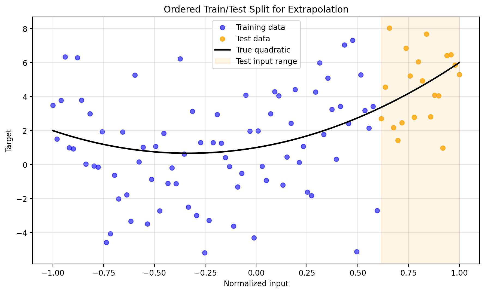
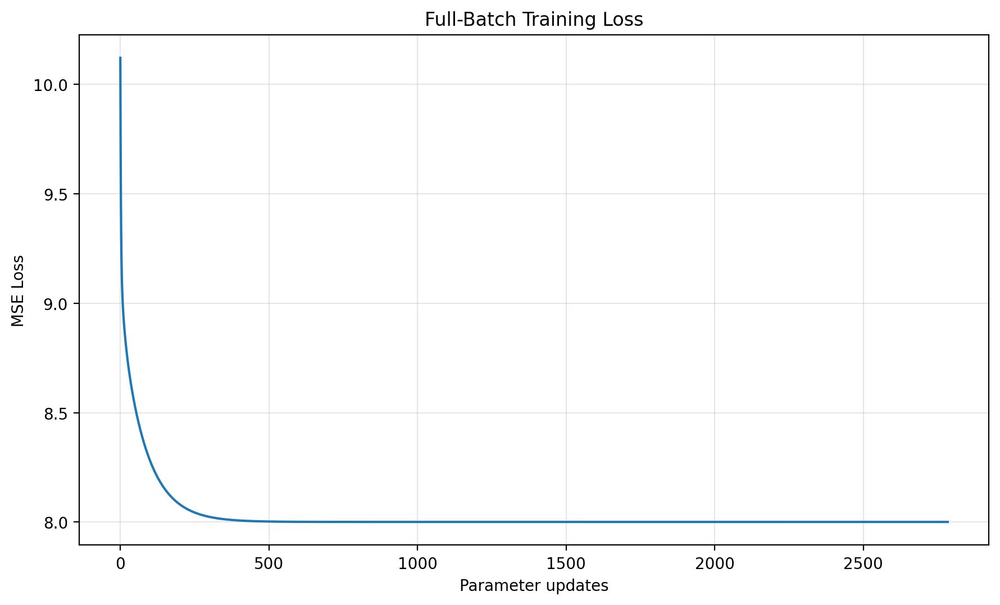
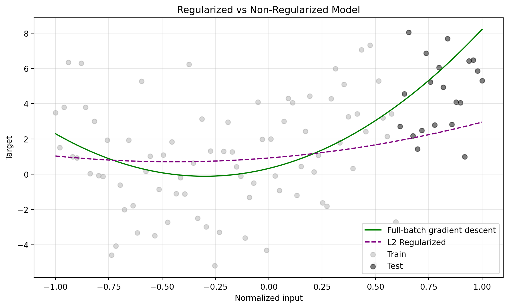
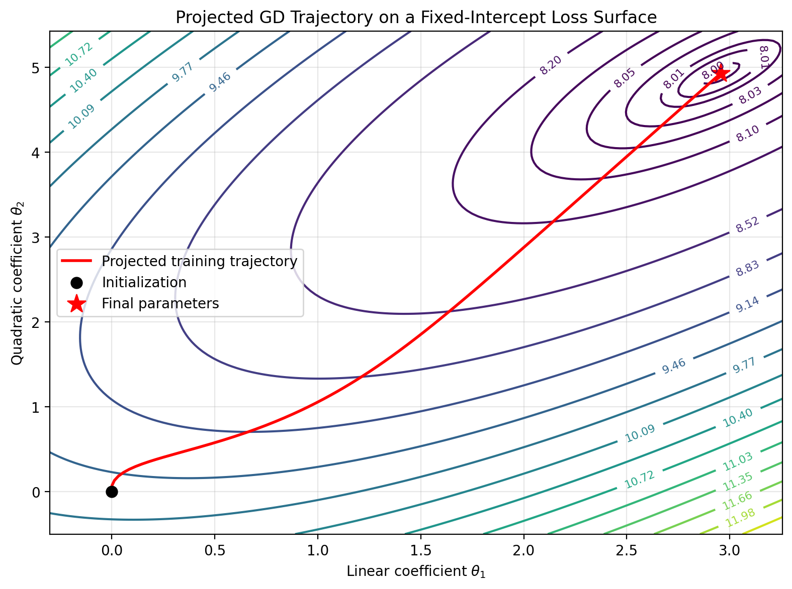

# Polynomial Regression from Scratch

Quadratic regression implemented with manually derived gradients and NumPy. This project examines convergence, mini-batch updates, and L2 regularization, and verifies the custom implementations against reference solvers.

**Key result:** full-batch gradient descent converges to the least-squares solution, matching NumPy, SciPy, and scikit-learn with a test MSE of approximately **6.77725**. L2 regularization shrinks the coefficients but increases test error in this experiment.

## Project overview

The notebook builds the prediction function, mean squared error, analytical gradients, and optimization loops explicitly. Library fitting methods are used as independent references rather than to train the custom models.

The analysis includes:

- Analytical gradients verified using central finite differences.
- Full-batch gradient descent with a gradient-norm stopping criterion.
- Shuffled mini-batch gradient descent with complete training epochs.
- A recorded parameter trajectory projected onto a fixed-intercept loss surface.
- L2 regression with an unpenalized intercept, verified against a direct regularized solution.
- A consolidated comparison with NumPy `polyfit`, SciPy `curve_fit`, and scikit-learn polynomial regression.

[Open the complete notebook](notebooks/polynomial_regression_from_scratch.ipynb).

## Data and evaluation

The notebook generates 100 synthetic observations; no external dataset or download is required. Raw inputs span −10 to 10 and are divided by 10 before targets are generated:

$$
x = u / 10, \qquad y = 1 + 2x + 3x^2 + \epsilon, \qquad \epsilon \sim \mathcal{N}(0, 3^2).
$$

The true coefficients in normalized input space are `[1, 2, 3]`. Although the curve is nonlinear in the input, it is linear in its parameters, so the unregularized MSE objective is convex.

The first 80 ordered observations form the training set; the final 20 form the test set. Training inputs span approximately **−1.000 to 0.596**, while test inputs span **0.616 to 1.000**. This is an **extrapolation evaluation**, not a shuffled split covering the same input range.

Data generation uses seed 42. Mini-batch shuffling uses a separate random generator with seed 42. No hyperparameters are selected using the test set.



## Methods and settings

| Method | Learning rate | Stopping rule | Additional settings |
|---|---:|---|---|
| Full-batch GD | 0.1 | Gradient norm ≤ 1e-8, at most 20,000 updates | Zero initialization; 2,784 updates in this run |
| Mini-batch GD | 0.01 | 5,000 complete epochs | Batch size 16; 25,000 updates; zero initialization |
| L2 GD | 0.1 | Penalized gradient norm ≤ 1e-8, at most 20,000 updates | λ = 0.1; intercept excluded; 663 updates in this run |

The regularized objective is MSE plus `λ × (linear_coefficient² + quadratic_coefficient²)`. Test evaluation reports ordinary MSE for every method.

## Results

All coefficients below use normalized inputs and are ordered as intercept, linear term, and quadratic term.

| Method | Intercept | Linear | Quadratic | Training MSE | Test MSE |
|---|---:|---:|---:|---:|---:|
| Full-batch GD | 0.324030 | 2.955590 | 4.924981 | 8.000609 | 6.777249 |
| Mini-batch GD | 0.327362 | 2.954679 | 4.926967 | 8.000626 | 6.789099 |
| L2 GD (λ = 0.1) | 0.916342 | 0.958432 | 1.071990 | 8.605059 | 8.515031 |
| NumPy polyfit | 0.324030 | 2.955590 | 4.924981 | 8.000609 | 6.777250 |
| SciPy curve_fit | 0.324030 | 2.955590 | 4.924981 | 8.000609 | 6.777250 |
| scikit-learn | 0.324030 | 2.955590 | 4.924981 | 8.000609 | 6.777250 |

Small differences in the last displayed digits reflect numerical precision and stopping tolerances.

Full-batch GD reaches the same unregularized optimum as the reference solvers. Mini-batch GD closely approximates that solution; a fixed learning rate allows fluctuations near the optimum. With λ = 0.1, the norm of the linear and quadratic coefficients falls from **5.744 to 1.438**, while test MSE rises from **6.777 to 8.515**. Regularization therefore does not improve prediction accuracy on this split.





## Optimization visualization

The contour plot holds the intercept at its final fitted value and overlays the recorded linear and quadratic coefficients. Because the intercept changes during training, the line is a projection of a three-parameter trajectory: contour values are not the actual training loss at every point along it. The separate loss curve records that loss directly.



## Repository contents

| Path | Purpose |
|---|---|
| `notebooks/polynomial_regression_from_scratch.ipynb` | Complete analysis, numerical checks, results, and figure generation |
| `figures/` | Nine PNG charts exported by the notebook |
| `requirements.txt` | Pinned direct dependencies from the verification environment |
| `.gitignore` | Excludes local environments, editor settings, and temporary files |

## Run locally

The notebook was verified using Python 3.12. Use Python 3.12 with the pinned dependencies to reproduce the verification environment's direct package versions. Transitive dependencies are resolved by pip; this is not a complete environment lockfile.

Clone the repository, or skip these commands if you already have a local checkout:

```powershell
git clone https://github.com/Lucid1498/polynomial-regression-from-scratch.git
cd polynomial-regression-from-scratch
```

From the repository root, create an environment and install the dependencies:

```powershell
py -3.12 -m venv .venv
.\.venv\Scripts\python.exe -m pip install -r requirements.txt
```

In VS Code:

1. Install the Python and Jupyter extensions if needed.
2. Open `notebooks/polynomial_regression_from_scratch.ipynb`.
3. Select `.venv` as the notebook's Python kernel.
4. Restart the kernel and run all cells from top to bottom.
5. Save the executed notebook.

The kernel's working directory must be the repository root, the `notebooks` directory, or another directory beneath the root. The notebook locates the project by its expected notebook path and automatically creates `figures/`.

## Figure exports

Running all cells creates or overwrites these 200-DPI PNG files:

| File | Visualization |
|---|---|
| `synthetic_quadratic_data.png` | Noisy observations and true quadratic |
| `extrapolation_split.png` | Ordered training/test split |
| `test_predictions.png` | Actual and predicted test targets |
| `fitted_quadratic.png` | Fitted curve across the full input domain |
| `full_batch_training_loss.png` | Training MSE by parameter update |
| `parameter_trajectory.png` | Projected optimization trajectory |
| `reference_solver_comparison.png` | Full-batch GD, NumPy, and SciPy curves |
| `mini_batch_comparison.png` | Full-batch and mini-batch curves |
| `l2_regularization_comparison.png` | Unregularized and L2-regularized curves |

## Validation and limitations

The notebook includes assertions for the analytical gradients, full-batch agreement with NumPy, SciPy agreement with NumPy, scikit-learn agreement with the unregularized solutions, and L2 agreement with its direct reference. A successful run completes these checks without assertion errors.

Results describe one synthetic dataset, one noise realization, and one ordered split with only 20 test observations. They do not establish performance on real-world data or other input domains. The regularization strength is fixed rather than tuned, and no runtime advantage is claimed for mini-batch training.

Possible extensions include repeated experiments across seeds, separate interpolation and extrapolation evaluations, learning-rate comparisons, and regularization selection using validation data.
